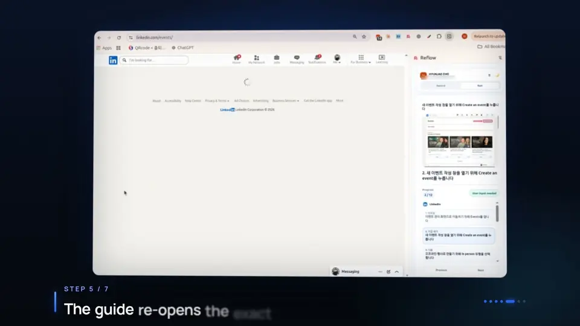
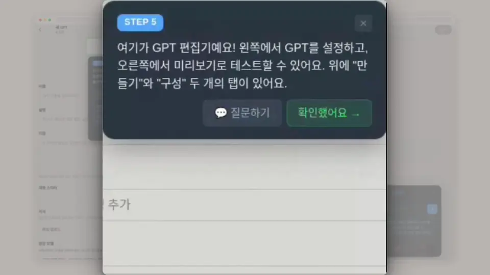
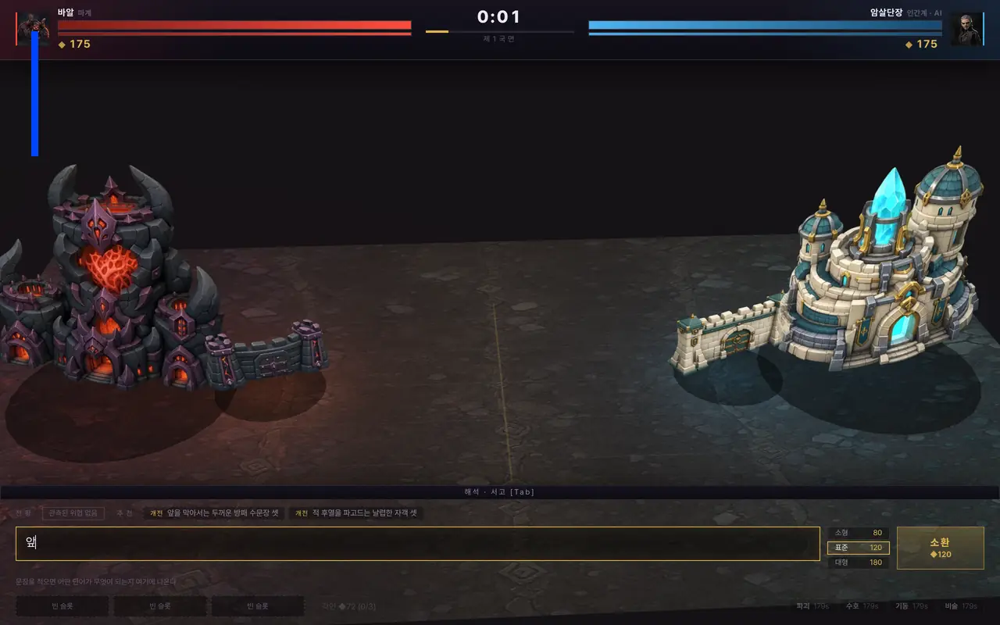
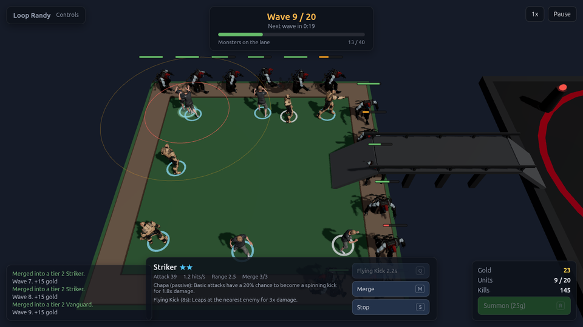
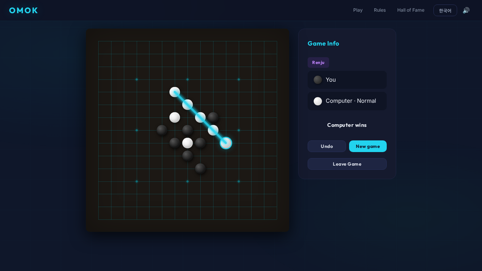

<p>
  <picture>
    <source media="(max-width: 600px)" srcset="media/header-narrow.svg">
    <source media="(prefers-color-scheme: dark)" srcset="media/header-dark.svg">
    
  </picture>
</p>

I build [Reflow](https://reflowguide.com): record a web workflow once and it becomes a step-by-step guide (a document, PDF, video and an overlay on the live page) that keeps working when the software's UI changes. It's on the [Chrome Web Store](https://chromewebstore.google.com/detail/reflow/oilikinlapenimjpkcilbjccjilnihef) and [Edge Add-ons](https://microsoftedge.microsoft.com/addons/detail/reflow/akpfafggaihnclnelalfffcgaknpipgi) with six paying customers in Korea. Its first prototype took **1st place among 3,295 participants** at the OpenAI x Primer x Jocoding AI Hackathon 2026.

**Now:** self-healing guides for Reflow, which replay a recorded workflow, notice when the UI has moved and prove a repair by running it again. The benchmark behind the repair step is public: [selector-heal](https://github.com/Jayyo/selector-heal). Applied to the Meta Global AI Developer Hackathon.

## Reflow

Record a workflow once. Clicks, typing and page changes become numbered steps with screenshots, and Reflow replays the guide on the real page, highlighting each field in order. Built for onboarding material, internal manuals and customer how-tos.

<a href="https://reflowguide.com"></a>

[reflowguide.com](https://reflowguide.com) · [Chrome Web Store](https://chromewebstore.google.com/detail/reflow/oilikinlapenimjpkcilbjccjilnihef) · [Edge Add-ons](https://microsoftedge.microsoft.com/addons/detail/reflow/akpfafggaihnclnelalfffcgaknpipgi) · the product code is private

### Where it started: ChatGPT Navigator, 1st place among 3,295

Built in February 2026 for the OpenAI x Primer x Jocoding AI Hackathon. You type a goal such as "create a custom GPT"; the extension reads the live page, an LLM plans the steps, and it highlights the next thing to click, moves on as you act and answers questions about the current step. It notices wrong clicks and waits for the page to settle before the next step.

<a href="https://www.youtube.com/watch?v=VklAdO7NaEU"></a>

[Code](https://github.com/Jayyo/reflow) · [Demo video (2:34)](https://www.youtube.com/watch?v=VklAdO7NaEU) · works on chatgpt.com only

## agent-page-helper

One dependency-free script for LLM browser agents. It lists a page's controls with short refs and acts on those refs: it fills React-controlled inputs, refuses to click what is covered, and reaches into same-origin iframes and open shadow roots. A real run on a test page where a cookie banner covers the Save button (the error line is shortened):

```text
> __aph__.snapshot({ format: 'text' })
h1 "Profile settings"
[gngc1] textbox "Display name" value="Mina"
[gngc2] button "Save changes" covered-by=[gngc3] div#consent
[gngc4] button "Accept all"
> __aph__.click('gngc2')
{"ok":false,"error":{"code":"OCCLUDED","message":"button#save is covered by div#consent", ...}}
> __aph__.click('gngc4')
{"ok":true,"ref":"gngc4"}
> __aph__.click('gngc2')
{"ok":true,"ref":"gngc2"}
```

On ten public pages the snapshot came to a median of 1,413 tokens, against 13,443 for Playwright's AI-mode aria snapshot. It is smaller because it keeps at most 100 controls and 400 characters of text, while the aria snapshot carries much more of the page.

[Code and benchmark](https://github.com/Jayyo/agent-page-helper)

## Tongue of War

Summon an army by writing a Korean sentence, and an LLM opponent answers with sentences of its own. Both go through the same deterministic parser and a budget compiler, so a sentence can shape an army but never buy it extra stats.

<a href="https://jayyo.github.io/tongue-of-war/"></a>

[Play in your browser](https://jayyo.github.io/tongue-of-war/) (against the scripted bot) · [Code](https://github.com/Jayyo/tongue-of-war) · the LLM opponent runs locally with an OpenAI, Gemini or DeepSeek key

## More projects

**[Loop Randy](https://github.com/Jayyo/loop-randy)**: a 3D random defense game in the style of Warcraft III custom maps, built in React Three Fiber with [Jinwoo Choung](https://github.com/vpsxkqktm). Summon, merge, survive 20 waves and the bosses. [Play in your browser](https://jayyo.github.io/loop-randy/)

**[Omok](https://github.com/Jayyo/gomoku)**: gomoku in plain JavaScript. The computer searches for forced wins in a Web Worker, and Renju's forbidden moves follow the RIF definitions. [Play in your browser](https://jayyo.github.io/gomoku/)

<p>
  <a href="https://jayyo.github.io/loop-randy/"></a>
  <a href="https://jayyo.github.io/gomoku/"></a>
</p>

**[DART Insider](https://github.com/Jayyo/dart-insider)**: Korean executives' trades in their own company's shares, parsed from OpenDART filings, with amounts from the filed prices and a price chart per trade.

**[Lecture Q&A](https://github.com/Jayyo/lecture-qa)**: pause a lecture video, ask a question, and get an answer from the timestamped transcript with links back to the moments it used.

**[AI News Today](https://github.com/Jayyo/ai-news-today)**: a Korean AI news digest built from RSS feeds. A model picks and summarizes the stories, and a summary is published only if every number and quoted phrase in it appears in the source; otherwise the outlet's lede is shown. [Read it](https://jayyo.github.io/ai-news-today/)

**[gpt-sovits-simple](https://github.com/Jayyo/gpt-sovits-simple)**: a command line tool and Python API for GPT-SoVITS text-to-speech.

---

Video versions of these demos are on [jayyo.github.io](https://jayyo.github.io). I also run a 350+ member AI study community in Sejong (40+ offline sessions).

[reflowguide.com](https://reflowguide.com) · [LinkedIn](https://www.linkedin.com/in/jaycho-reflow) · [jayyo.github.io](https://jayyo.github.io)
