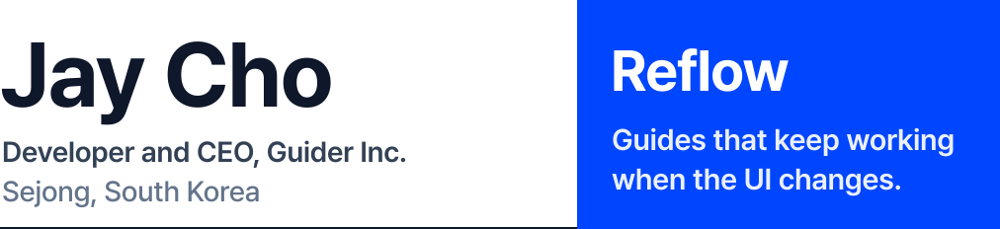
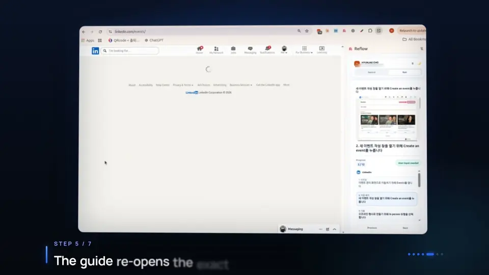
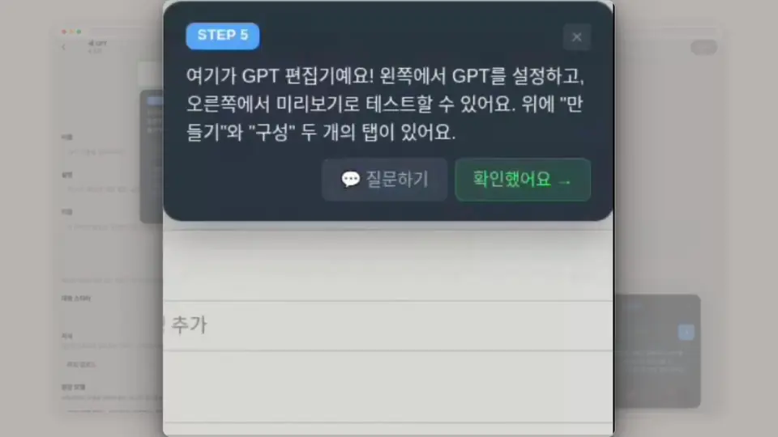
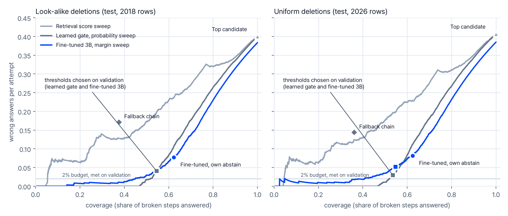
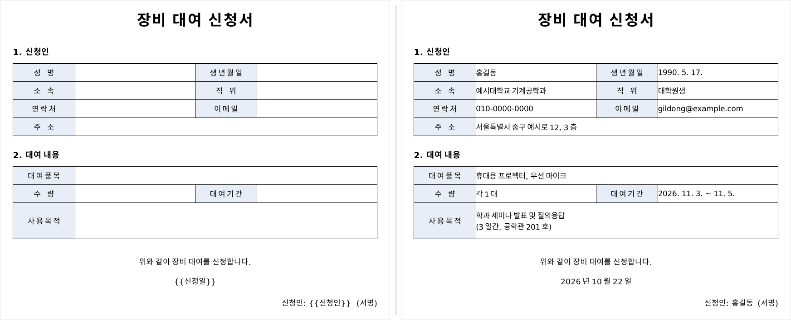

<p>
  <picture>
    <source media="(max-width: 600px)" srcset="media/header-narrow.svg">
    <source media="(prefers-color-scheme: dark)" srcset="media/header-dark.svg">
    
  </picture>
</p>

I build [Reflow](https://reflowguide.com): record a web workflow once and it becomes a step-by-step guide (a document, PDF, video and an overlay on the live page) that keeps working when the software's UI changes. It's on the [Chrome Web Store](https://chromewebstore.google.com/detail/reflow/oilikinlapenimjpkcilbjccjilnihef) and [Edge Add-ons](https://microsoftedge.microsoft.com/addons/detail/reflow/akpfafggaihnclnelalfffcgaknpipgi) with six paying customers in Korea. Its first prototype took **1st place among 3,295 participants** at the OpenAI x Primer x Jocoding AI Hackathon 2026.

**Now:** self-healing guides for Reflow, which replay a recorded workflow, notice when the UI has moved and prove a repair by running it again. The benchmark behind the repair step is public: [selector-heal](https://github.com/Jayyo/selector-heal). Applied to the Meta Global AI Developer Hackathon.

## Reflow

Record a workflow once. Clicks, typing and page changes become numbered steps with screenshots, and Reflow replays the guide on the real page, highlighting each field in order. Built for onboarding material, internal manuals and customer how-tos.

<a href="https://reflowguide.com"></a>

[reflowguide.com](https://reflowguide.com) · [Chrome Web Store](https://chromewebstore.google.com/detail/reflow/oilikinlapenimjpkcilbjccjilnihef) · [Edge Add-ons](https://microsoftedge.microsoft.com/addons/detail/reflow/akpfafggaihnclnelalfffcgaknpipgi) · the product code is private

### Where it started: ChatGPT Navigator, 1st place among 3,295

Built in February 2026 for the OpenAI x Primer x Jocoding AI Hackathon. You type a goal such as "create a custom GPT"; the extension reads the live page, an LLM plans the steps, and it highlights the next thing to click, moves on as you act and answers questions about the current step. It notices wrong clicks and waits for the page to settle before the next step.

<a href="https://www.youtube.com/watch?v=VklAdO7NaEU"></a>

[Code](https://github.com/Jayyo/reflow) · [Demo video (2:34)](https://www.youtube.com/watch?v=VklAdO7NaEU) · works on chatgpt.com only

## agent-page-helper

One dependency-free script for LLM browser agents. It lists a page's controls with short refs and acts on those refs: it fills React-controlled inputs, refuses to click what is covered, and reaches into same-origin iframes and open shadow roots. A real run on a test page where a cookie banner covers the Save button (the error line is shortened):

```text
> __aph__.snapshot({ format: 'text' })
h1 "Profile settings"
[gngc1] textbox "Display name" value="Mina"
[gngc2] button "Save changes" covered-by=[gngc3] div#consent
[gngc4] button "Accept all"
> __aph__.click('gngc2')
{"ok":false,"error":{"code":"OCCLUDED","message":"button#save is covered by div#consent", ...}}
> __aph__.click('gngc4')
{"ok":true,"ref":"gngc4"}
> __aph__.click('gngc2')
{"ok":true,"ref":"gngc2"}
```

On ten public pages the snapshot came to a median of 1,413 tokens, against 13,443 for Playwright's AI-mode aria snapshot. It is smaller because it keeps at most 100 controls and 400 characters of text, while the aria snapshot carries much more of the page.

[Code and benchmark](https://github.com/Jayyo/agent-page-helper)

## selector-heal

The repair step behind self-healing guides, measured in public. A recorded step stores a locator; after a UI change it can match nothing, several elements, or quietly the wrong one. Given the recorded element and the changed page, pick the element that does the same job now, or say it is gone. Every method is scored on what it repairs and on how often it is wrong when it answers, because a confident wrong repair is worse than asking.

<a href="https://github.com/Jayyo/selector-heal"></a>

On 2,018 broken steps from 55 held-out sites, taking the top retrieved candidate finds the right element 89% of the time and is still wrong on 40% of its answers, since it also "repairs" controls that were deleted. A 12-feature logistic gate and a QLoRA fine-tuned Qwen2.5-3B both get that down to about 4% while answering 55%.

[Code, method and full results](https://github.com/Jayyo/selector-heal)

## hwpx-fill

Korean public institutions still run on 한글 (HWP/HWPX) forms. hwpx-fill fills and edits them from Python on Linux without Hancom Office: it finds labels spaced out for justification (`성    명`), fills all or nothing, and moves tables and pictures from last year's submission into this year's form.

<a href="https://github.com/Jayyo/hwpx-fill"></a>

[Code](https://github.com/Jayyo/hwpx-fill) · `pip install git+https://github.com/Jayyo/hwpx-fill`

## More projects

**[DART Insider](https://github.com/Jayyo/dart-insider)**: Korean executives' trades in their own company's shares, parsed from OpenDART filings, with amounts from the filed prices and a price chart per trade.

**[Lecture Q&A](https://github.com/Jayyo/lecture-qa)**: pause a lecture video, ask a question, and get an answer from the timestamped transcript with links back to the moments it used.

**[AI News Today](https://github.com/Jayyo/ai-news-today)**: a Korean AI news digest built from RSS feeds. A model picks and summarizes the stories, and a summary is published only if every number and quoted phrase in it appears in the source; otherwise the outlet's lede is shown. [Read it](https://jayyo.github.io/ai-news-today/)

**[gpt-sovits-simple](https://github.com/Jayyo/gpt-sovits-simple)**: a command line tool and Python API for GPT-SoVITS text-to-speech.

**[bassless](https://github.com/Jayyo/bassless)**: practice tracks with the bass taken out, which I use while teaching myself bass. Demucs does the separation; the practice track is the original minus the bass stem, and the README has the measurements behind that choice.

---

I also run a 350+ member AI study community in Sejong (40+ offline sessions).

[reflowguide.com](https://reflowguide.com) · [LinkedIn](https://www.linkedin.com/in/jaycho-reflow)
